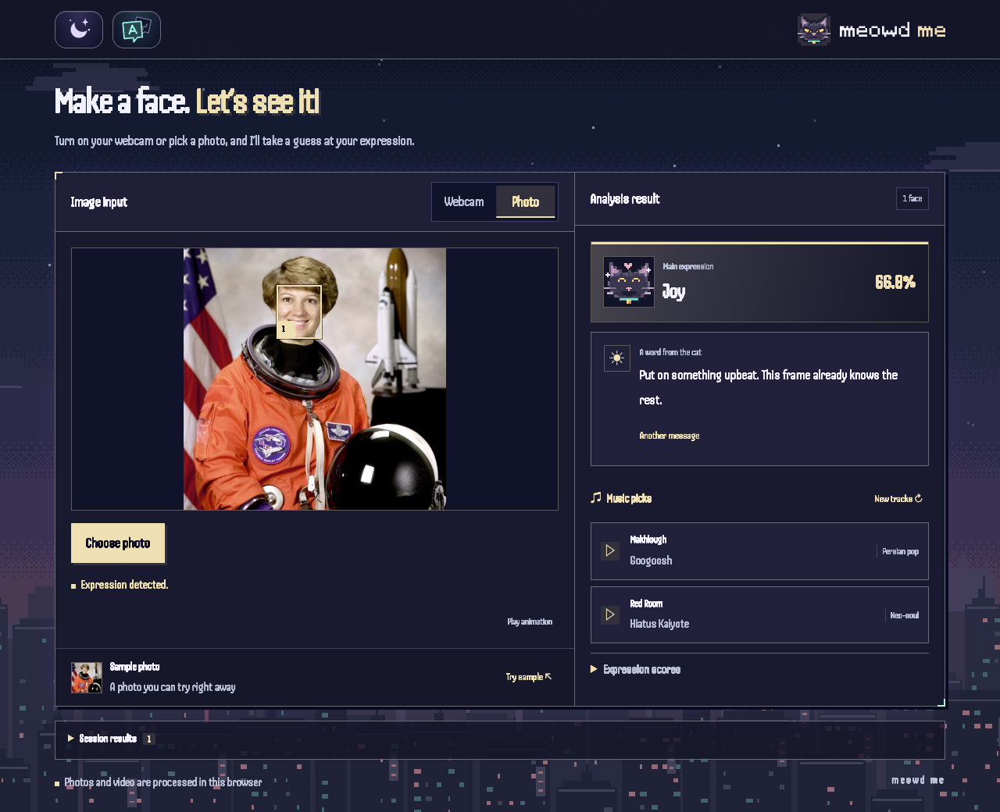

<p align="center">
  
</p>

<h1 align="center">meowd me</h1>

<p align="center"><strong>Make a face. Let’s see it!</strong></p>
<p align="center">A bilingual pixel-art studio for exploring facial expressions from a photo or webcam. Models run in your browser.</p>

<p align="center">
  <a href="#run-locally">Quick start</a> ·
  <a href="#how-analysis-works">How it works</a> ·
  <a href="#privacy">Privacy</a>
</p>



## About

Pick a photo or turn on your webcam and watch the grumpy pixel cat react to the expression it sees. The interface colors, the cat’s comments, and the music suggestions change with the result.

| Feature | What you can do |
| --- | --- |
| Photo and webcam input | Upload a photo, use a live webcam feed, or try the built-in sample. |
| Multiple faces | Select a face to see its result and individual expression scores. |
| Blended expressions | See a combination such as joy and surprise when both the model scores and visible facial cues support it. |
| Possible tiredness | See when webcam footage shows a sustained or repeated eye-closure pattern. |
| Pixel-art interface | Switch between light and dark themes and between English and Persian. |
| Session results | Review recent results and expand the score breakdown when you need it. |

## Run locally

You’ll need Python 3 and a modern browser. Clone the repository and start the local server.

```bash
git clone https://github.com/AytanDalfardi/MeowdMe.git
cd MeowdMe
python3 -m http.server 8765 --bind 127.0.0.1 --directory dist
```

1. Open the [local welcome page](http://127.0.0.1:8765/) and enter the studio.
2. Choose **Try sample** to see a result quickly. For live analysis, choose **Turn on webcam** and grant camera access.
3. If the image contains multiple faces, select one. Expand **Expression scores** for the breakdown.

The models and runtime dependencies ship in [`dist/assets/`](dist/assets/). There’s no build step. For webcam access, open the app on localhost or an HTTPS host.

## How analysis works

1. **MediaPipe Face Landmarker** finds faces and key landmarks. The app uses the eye line to correct head tilt and checks flipped views for still photos.
2. **MobileViT** and **MobileFaceNet** estimate facial expressions. **EfficientNet-B2** performs a third check when the initial estimates need more evidence.
3. For webcam input, the app smooths scores over successive frames for each face. The result indicates uncertainty when competing scores are close.
4. **ONNX Runtime Web** runs inference in the browser. MobileViT uses WebGPU where supported and falls back to WebAssembly.

The model scores eight categories of visible facial expression. Treat each result as an estimate of what the image shows. Lighting, pose, and partial faces can affect the result. The possible-tiredness label comes from eye-closure patterns in webcam footage, which can have several causes.

## Privacy

Photos and webcam frames are processed in your browser. Reloading the page clears session results. Language, theme, and motion preferences are kept locally.

The app fetches public catalog entries from Apple and poems from Ganjoor to refresh recommendations. The requests contain no photos, frames, analysis results, or selected expressions. The app also includes offline suggestions.

## Project structure

| Path | Purpose |
| --- | --- |
| [`dist/index.html`](dist/index.html) and [`dist/studio.html`](dist/studio.html) | Welcome page and expression studio |
| [`dist/app.js`](dist/app.js) | Camera and photo input, results, and preferences |
| [`dist/face-landmarks.js`](dist/face-landmarks.js) and [`dist/expression.js`](dist/expression.js) | Face landmarks and expression models |
| [`dist/compound.js`](dist/compound.js) and [`dist/alertness.js`](dist/alertness.js) | Blended expressions and eye-closure cues |
| [`dist/pixels.js`](dist/pixels.js) and [`dist/assets/`](dist/assets/) | Animations, artwork, fonts, and bundled models |

## Deploy to GitHub Pages

The [GitHub Pages workflow](.github/workflows/pages.yml) publishes the static files in `dist`. In the repository, open **Settings → Pages** and set **Source** to **GitHub Actions**. GitHub shows the site URL there after a successful deployment.

## Credits and third-party licenses

- [MediaPipe Face Landmarker](https://developers.google.com/edge/mediapipe/solutions/vision/face_landmarker) and the [MediaPipe license](dist/assets/vendor/mediapipe/LICENSE)
- [EmotiEffLib](https://github.com/sb-ai-lab/EmotiEffLib/tree/520a051c64cd191521e5934655314e769a319684) for MobileViT and EfficientNet-B2. [License](dist/assets/models/emotiefflib.LICENSE)
- [OpenCV Zoo](https://github.com/opencv/opencv_zoo/tree/main/models/facial_expression_recognition) for MobileFaceNet. [License](dist/assets/models/opencv-zoo.LICENSE)
- [ONNX Runtime Web](https://github.com/microsoft/onnxruntime/tree/v1.22.0) and its [third-party notices](dist/assets/vendor/ort/ThirdPartyNotices.txt)
- [Apple iTunes Search API](https://performance-partners.apple.com/search-api) and [Ganjoor’s public data](https://github.com/ganjoor/ganjoor-data/blob/main/API.md)
- [NASA’s public-domain sample photo of Eileen Collins](https://scikit-image.org/docs/0.25.x/api/skimage.data.html#skimage.data.astronaut)
- [Handjet](dist/assets/vendor/handjet.LICENSE) and [Vazirmatn](dist/assets/vendor/vazirmatn.LICENSE), both under the SIL Open Font License
